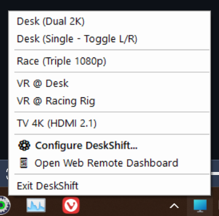
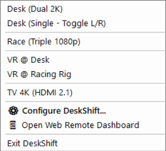
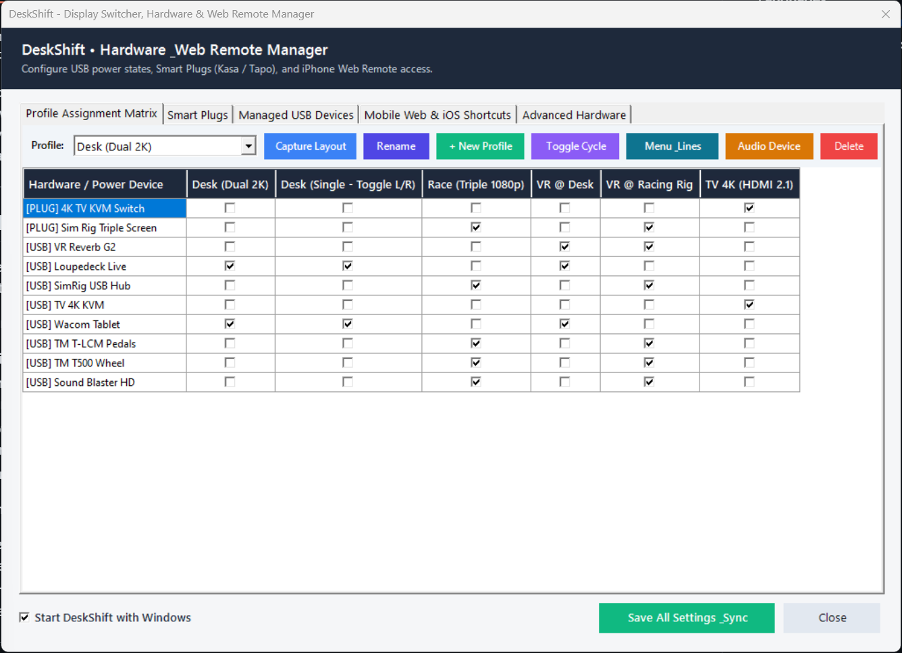
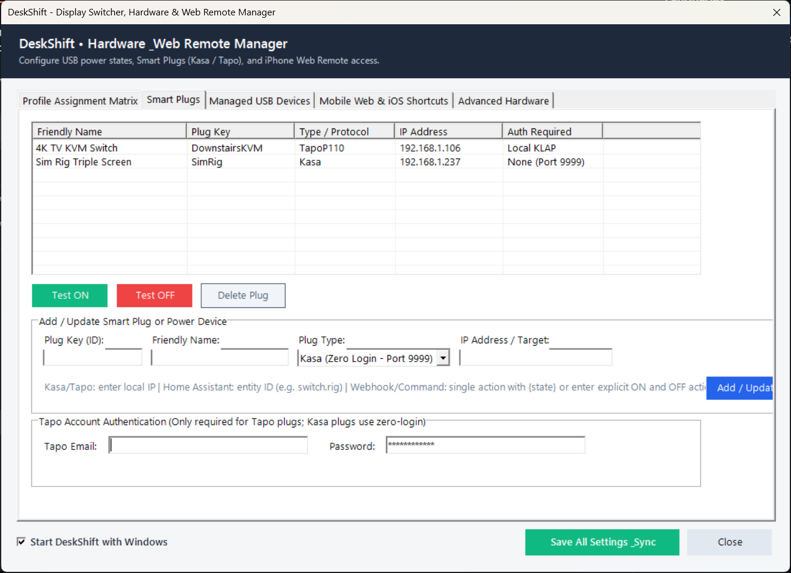
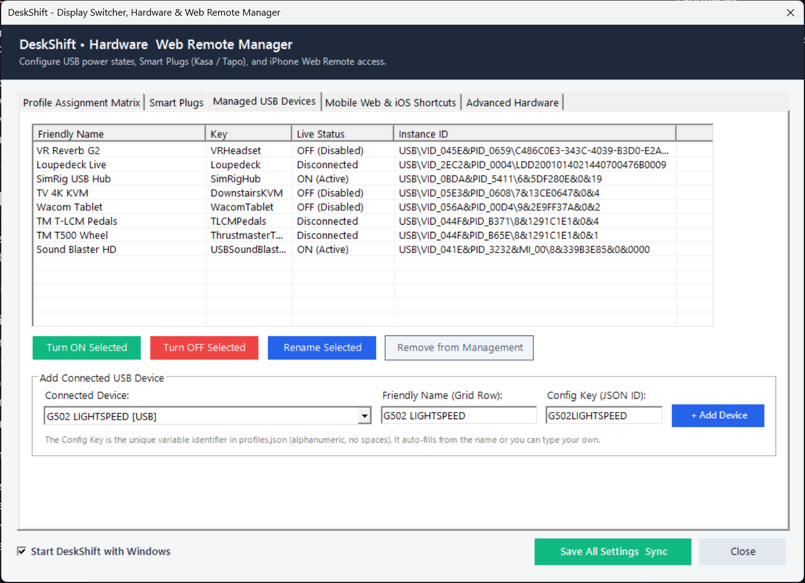
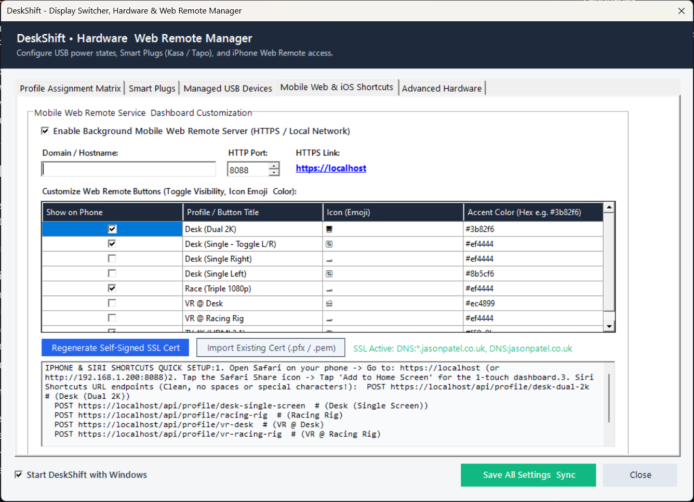

# DeskShift

Native Win32 display, audio, USB peripheral, and smart plug switcher for Windows 10 and 11.

DeskShift is a standalone system tray utility designed for multi-display workstations and gaming setups—especially single PCs powering both a desk workstation and a sim rig, triple-screen setup, VR headset, or TV.

Traditional utilities often rely on virtual display drivers or slow enumeration that causes desktop flicker, scrambled window layouts, and lost audio routing. DeskShift interacts directly with the Windows Connecting and Configuring Displays (CCD) API (`SetDisplayConfig`), switching display topologies in tens of milliseconds while orchestrating USB hardware and power states in a single atomic profile action.

---

## The Problem: The Single-PC Workstation & Sim Rig Dilemma

Many enthusiasts run a high-performance PC that drives both everyday desk monitors (e.g., dual 2K screens) and a dedicated sim racing cockpit (e.g., triple 1440p screens, VR headsets, direct-drive wheels, and pedals).

Switching between them manually is painful:
1. **Windows Display Settings** frequently scrambles monitor order, refresh rates, and desktop icon positions.
2. **Ghost USB Controllers:** Windows games often detect racing wheels or pedals while you are trying to play normal games or work at your desk.
3. **Power Draw & Standby Issues:** Triple screens and heavy peripherals left powered on draw unnecessary power and can wake unexpectedly.
4. **Audio Routing:** Windows often fails to switch the default sound output to the correct headset or speaker system.

**DeskShift solves this with a single click or mobile tap:**
- **Desk Profile:** Restores dual desk monitors, sets desk speakers, enables tablet/productivity USBs, and cuts power to the sim rig via smart plug.
- **Sim Rig Profile:** Powers up rig screens via smart plug, enables direct-drive wheel/pedal USB devices in Device Manager, applies the triple-screen topology with exact refresh rates, and routes audio to the rig headset.

<p align="center">
  
  
</p>

---

## Configuration Interface

DeskShift provides a native Win32 GUI configurator (`Configure-DeskShift.ps1`) to capture display topologies, assign audio playback devices, manage smart plug relays, and map USB peripherals:

| Profile Assignment Matrix | Smart Plug Configuration |
| :---: | :---: |
|  |  |

| Managed USB Hardware | Mobile Web & iOS Shortcuts |
| :---: | :---: |
|  |  |

---

## Features

- **Win32 CCD Display Switching:** Applies captured monitor topologies (resolutions, positions, refresh rates, orientations) directly through Windows native display APIs.
- **Configurable Toggle Cycles:** Set up multi-way toggle sequences to cycle through layouts with a single shortcut or menu click (for example: Dual Screen -> Single Right -> Single Left).
- **Default Audio Device Synchronization:** Automatically changes the default Windows playback endpoint to match the active profile (e.g. desk speakers, headset, or TV audio).
- **Smart Plug Automation:** Powers external display hardware on or off per profile:
  - **TP-Link Kasa:** Local network control over port 9999 without cloud authentication.
  - **TP-Link Tapo:** Local KLAP/SPAKE2+ protocol support.
  - **Home Assistant:** REST API calls (`switch.turn_on` / `switch.turn_off`) with access token support.
  - **HTTP Webhooks / REST:** Compatible with Shelly, Tasmota, ESPHome, and custom endpoints via URL templates or explicit ON/OFF URLs.
  - **Custom Shell Commands:** Runs user-defined CLI commands with optional `{state}` parameter substitution.
- **USB and PnP Device Management:** Enables or disables specific USB peripherals (such as racing wheels, pedals, tablets, or VR trackers) based on the active profile.
- **Mobile Web Remote:** Optional local web interface accessible from a phone browser, with clean REST endpoints suitable for iOS Shortcuts or automation scripts.
- **Portable and Standalone:** Runs from its folder without an installer or registry alterations outside optional autostart.

---

## Directory Structure

```
DeskShift/
├── DeskShift.lnk            # Shortcut to start the background tray engine silently
├── Configure-DeskShift.ps1  # GUI configuration tool and profile matrix editor
├── scripts/                 # Core automation scripts and certificate helper
├── config/                  # Master profiles.json and captured CCD display files
├── icons/                   # Tray icons
├── bin/                     # NativeEngine helper executable for CCD and PnP calls
├── src/                     # C# source code and build script for NativeEngine
│   └── NativeEngine/        # NativeDisplay.cs, NativeHardwareSuite.cs, and build.bat
└── web-remote/              # Mobile dashboard and local HTTP/HTTPS server
```

---

## Getting Started

### 1. Launching DeskShift
Run `DeskShift.lnk` (or `DeskShift.vbs`). An icon will appear in the Windows system tray.

### 2. Capturing and Configuring Profiles
Right-click the tray icon and select **Configure DeskShift...** (or launch `Configure-DeskShift.ps1` directly):

1. **Capture Layout:** Arrange your monitors in Windows Settings, choose a target profile in the dropdown, and click **Capture Layout**.
2. **Assign Audio:** Click **Audio Device** to choose which playback device activates with that display setup.
3. **Hardware Matrix:** In the **Power & Device Matrix** table, select which smart plugs and USB devices should be active for each profile.
4. **Windows Autostart:** Select **Start DeskShift with Windows** if you want the tray engine to run on system logon.

### 3. iOS Shortcuts, Stream Deck & Automation Setup

DeskShift includes a built-in mobile web dashboard and REST API server in `web-remote/`:

1. If using the optional mobile web remote, install its dependencies once:
   ```cmd
   cd web-remote
   npm install
   ```
2. Open the **Mobile Web & iOS Shortcuts** tab in the configurator.
3. Ensure the remote server toggle is enabled.
4. The instructions pane lists direct `POST` URLs formatted with clean slugs for each profile (e.g., `POST https://<your-ip>:8443/api/profile/racing-rig`).
5. **iOS Shortcuts:**
   - Add a **Get Contents of URL** action.
   - Set HTTP Method to `POST`.
   - Paste the target endpoint URL.
6. **Elgato Stream Deck / External Tools:**
   - Use the **System: Website** action with an HTTP POST request, or trigger a local CLI shortcut:
     ```cmd
     powershell -ExecutionPolicy Bypass -File "scripts\DeskShift.ps1" -Profile "Racing Rig"
     ```
7. **Local HTTPS Certificate:**
   - If using HTTPS with a self-signed certificate on your local network, click **Regenerate Self-Signed SSL Cert** in the configurator to generate a certificate covering your machine's current local IP address.

---

## Smart Plug Configuration

Plugs are configured under the **Smart Plugs** tab:

| Type | Target Address / Value | Notes |
| :--- | :--- | :--- |
| **Kasa** | `192.168.1.50` | Direct local port 9999 control |
| **Tapo** | `192.168.1.51` | Uses local credentials defined in the settings tab |
| **Home Assistant** | `switch.rig_monitors` | Requires a Long-Lived Access Token |
| **HTTP Webhook** | `http://192.168.1.52/relay/0?turn={state}` | Shelly, Tasmota, ESPHome; separate ON and OFF URLs supported |
| **Custom Command** | `python switch.py {state}` | Local CLI command; separate ON and OFF commands supported |

---

## NativeEngine and Building from Source

DeskShift uses a lightweight native helper executable, `bin/NativeEngine.exe`, to call Win32 APIs that are either unavailable or slow to invoke repeatedly via PowerShell:
- **Win32 CCD (`SetDisplayConfig` / `QueryDisplayConfig`):** Fast query, capture, and restoration of display paths, modes, and desktop coordinates.
- **SetupAPI / PnP Device Management:** Fast enumeration, enablement, and disablement of USB hardware devices by Instance ID without WMI query overhead.

The binary is pre-built in `bin/NativeEngine.exe`. Complete C# source code and a standalone build script are included in `src/NativeEngine/`.

### Building from Source

NativeEngine has no external SDK or NuGet dependencies. It compiles using the standard Microsoft .NET Framework C# compiler (`csc.exe`) built into Windows:

1. Open a command prompt or run:
   ```cmd
   cd src\NativeEngine
   build.bat
   ```
2. The batch script invokes:
   ```cmd
   %WINDIR%\Microsoft.NET\Framework64\v4.0.30319\csc.exe /nologo /target:exe /main:NativeEngine.Program /platform:anycpu /out:"..\..\bin\NativeEngine.exe" NativeDisplay.cs NativeHardwareSuite.cs
   ```
3. The newly compiled executable is output directly to `bin\NativeEngine.exe`.

---

## License

MIT License.
